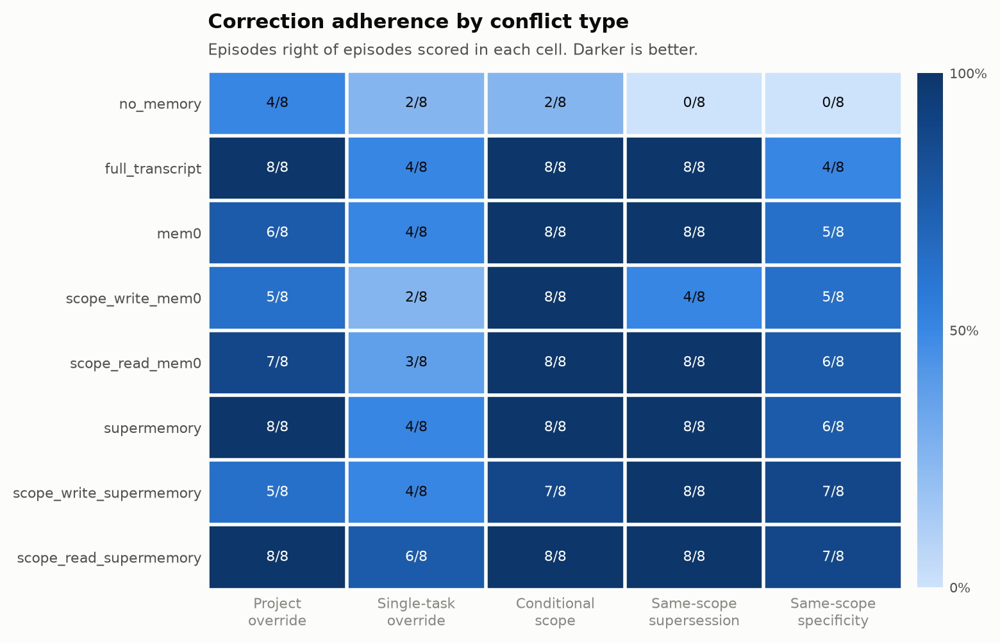
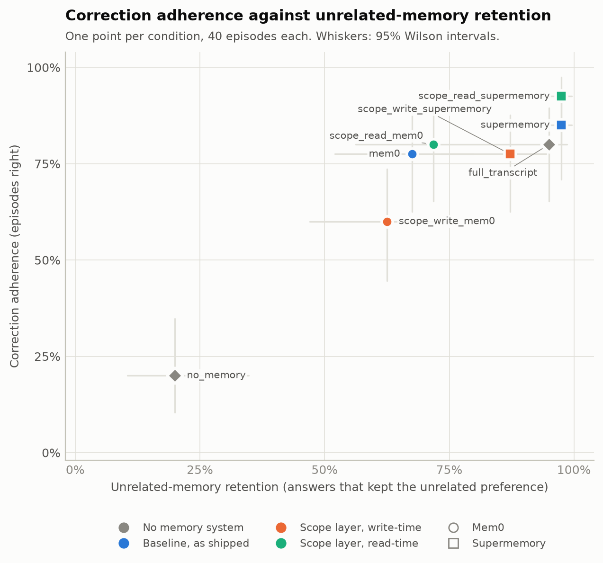
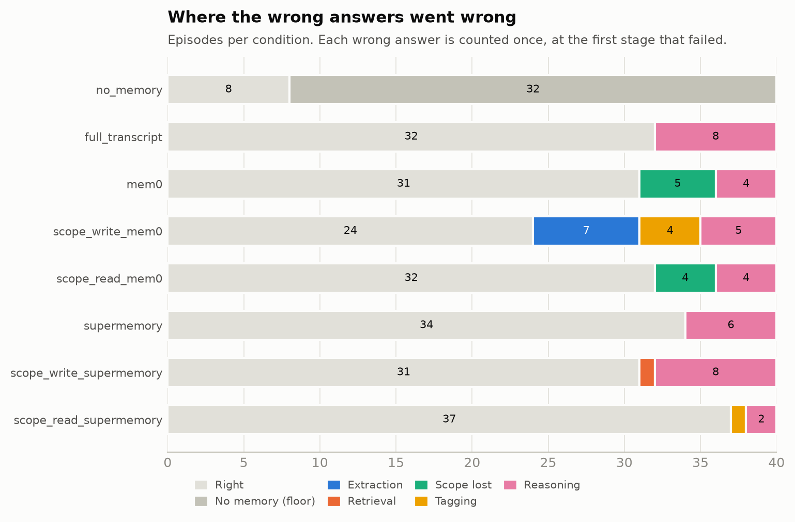

# Step 7 results

Scored 2026-10-24 21:35 UTC from 320 run logs in `/Users/nicngck/Desktop/DSA4213/Group Project/dsa4213-project-code/runs/logs`. Agent model `qwen/qwen3.8-flash`. Judge model `qwen/qwen3.8-flash` (prompt `judge-v1`). Gold labels: **draft**.
Run errors (not scored): 0. Answers with no judged action: 0. Judge spend so far on this machine: $0.0601.

Tagging accuracy uses the drafted gold labels. Rerun this after the annotators adjudicate them (README Step 3).

## 1. Correction adherence

| Condition | Role | Episodes right (95% CI) | In scope (A) | Out of scope (B) | Pairs, both right (95% CI) |
| --- | --- | --- | --- | --- | --- |
| no_memory | floor | 8/40 = 20% (10–35) | 4/20 | 4/20 | 0/20 = 0% (0–16) |
| full_transcript | control | 32/40 = 80% (65–90) | 17/20 | 15/20 | 13/20 = 65% (43–82) |
| mem0 | baseline | 31/40 = 78% (62–88) | 17/20 | 14/20 | 11/20 = 55% (34–74) |
| scope_write_mem0 | treatment | 24/40 = 60% (45–74) | 10/20 | 14/20 | 8/20 = 40% (22–61) |
| scope_read_mem0 | treatment | 32/40 = 80% (65–90) | 16/20 | 16/20 | 13/20 = 65% (43–82) |
| supermemory | baseline | 34/40 = 85% (71–93) | 18/20 | 16/20 | 15/20 = 75% (53–89) |
| scope_write_supermemory | treatment | 31/40 = 78% (62–88) | 11/20 | 20/20 | 11/20 = 55% (34–74) |
| scope_read_supermemory | treatment | 37/40 = 92% (80–97) | 20/20 | 17/20 | 17/20 = 85% (64–95) |

Probe A sits inside the scoped memory's scope, so a miss there is under-application. Probe B sits outside it, so a miss is over-application. A pair counts only when both halves are right, so an agent that always picks the same memory, the newest one or the standing one, scores no pairs.

## 2. Adherence by conflict type

| Condition | Project override | Single-task override | Conditional scope | Same-scope supersession | Same-scope specificity |
| --- | --- | --- | --- | --- | --- |
| no_memory | 4/8 | 2/8 | 2/8 | 0/8 | 0/8 |
| full_transcript | 8/8 | 4/8 | 8/8 | 8/8 | 4/8 |
| mem0 | 6/8 | 4/8 | 8/8 | 8/8 | 5/8 |
| scope_write_mem0 | 5/8 | 2/8 | 8/8 | 4/8 | 5/8 |
| scope_read_mem0 | 7/8 | 3/8 | 8/8 | 8/8 | 6/8 |
| supermemory | 8/8 | 4/8 | 8/8 | 8/8 | 6/8 |
| scope_write_supermemory | 5/8 | 4/8 | 7/8 | 8/8 | 7/8 |
| scope_read_supermemory | 8/8 | 6/8 | 8/8 | 8/8 | 7/8 |

Episodes right of episodes scored. Same-scope supersession and same-scope specificity test the two rules that settle conflicts inside one scope (rules 4 and 3), which is the lecturer's question about same-scope conflicts.

## 3. Unrelated-memory retention

| Condition | Answers that kept the unrelated preference (95% CI) | Project override | Single-task override | Conditional scope | Same-scope supersession | Same-scope specificity |
| --- | --- | --- | --- | --- | --- | --- |
| no_memory | 8/40 = 20% (10–35) | 50% | 25% | 25% | 0% | 0% |
| full_transcript | 38/40 = 95% (83–99) | 100% | 75% | 100% | 100% | 100% |
| mem0 | 27/40 = 68% (52–80) | 50% | 75% | 75% | 62% | 75% |
| scope_write_mem0 | 25/40 = 62% (47–76) | 50% | 100% | 75% | 38% | 50% |
| scope_read_mem0 | 28/39 = 72% (56–83) | 50% | 88% | 86% | 62% | 75% |
| supermemory | 39/40 = 98% (87–100) | 100% | 88% | 100% | 100% | 100% |
| scope_write_supermemory | 34/39 = 87% (73–94) | 88% | 100% | 100% | 71% | 75% |
| scope_read_supermemory | 39/40 = 98% (87–100) | 100% | 100% | 100% | 100% | 88% |

Each pair has an unrelated standing preference and a check the answer can be read against (`retention_checks`). The no-memory row is how often the agent does it anyway.

## 4. Retrieval vs action

| Condition | Retrieved right, acted right | **Retrieved right, acted wrong** | Retrieved wrong, acted right | Retrieved wrong, acted wrong | Wrong when retrieval was right |
| --- | --- | --- | --- | --- | --- |
| no_memory | 0 | **0** | 8 | 32 | – |
| full_transcript | 32 | **8** | 0 | 0 | 20% |
| mem0 | 31 | **9** | 0 | 0 | 22% |
| scope_write_mem0 | 23 | **9** | 1 | 7 | 28% |
| scope_read_mem0 | 32 | **8** | 0 | 0 | 20% |
| supermemory | 34 | **6** | 0 | 0 | 15% |
| scope_write_supermemory | 31 | **8** | 0 | 1 | 21% |
| scope_read_supermemory | 37 | **3** | 0 | 0 | 8% |

Retrieved right means the memory that should win was among the retrieved notes, matched word for word or by the judge. No memory counts as retrieved wrong and the full transcript as retrieved right. The bold column is the gap the project is about: the right memory was in front of the agent and it still acted wrong.

## 5. Where failures happen

| Condition | Episodes | correct | no memory | extraction | retrieval | scope lost | tagging | reasoning | unknown |
| --- | --- | --- | --- | --- | --- | --- | --- | --- | --- |
| no_memory | 40 | 8 | 32 | 0 | 0 | 0 | 0 | 0 | 0 |
| full_transcript | 40 | 32 | 0 | 0 | 0 | 0 | 0 | 8 | 0 |
| mem0 | 40 | 31 | 0 | 0 | 0 | 5 | 0 | 4 | 0 |
| scope_write_mem0 | 40 | 24 | 0 | 7 | 0 | 0 | 4 | 5 | 0 |
| scope_read_mem0 | 40 | 32 | 0 | 0 | 0 | 4 | 0 | 4 | 0 |
| supermemory | 40 | 34 | 0 | 0 | 0 | 0 | 0 | 6 | 0 |
| scope_write_supermemory | 40 | 31 | 0 | 0 | 1 | 0 | 0 | 8 | 0 |
| scope_read_supermemory | 40 | 37 | 0 | 0 | 0 | 0 | 1 | 2 | 0 |

Each wrong answer is counted once, at the first stage that failed. Extraction: Mem0 did not keep the memory that should win. Retrieval: it was not retrieved. Scope lost: a competing memory reached the agent without its project, task or condition. Tagging: the scope layer's tag on a competing memory was wrong or missing. Reasoning: the agent had everything it needed. Supermemory lists documents rather than the memories it extracts, so its extraction losses show up as retrieval.

What the wrong answers did:

| Condition | Over-applied | Under-applied | Superseded memory | Other action | Hedged | Default (no memory) | Over-apply rate, probe B | Under-apply rate, probe A |
| --- | --- | --- | --- | --- | --- | --- | --- | --- |
| no_memory | 0 | 0 | 0 | 14 | 0 | 18 | 0% | 0% |
| full_transcript | 4 | 3 | 0 | 0 | 1 | 0 | 20% | 10% |
| mem0 | 5 | 4 | 0 | 0 | 0 | 0 | 25% | 15% |
| scope_write_mem0 | 4 | 9 | 1 | 2 | 0 | 0 | 20% | 45% |
| scope_read_mem0 | 4 | 4 | 0 | 0 | 0 | 0 | 20% | 20% |
| supermemory | 4 | 1 | 0 | 0 | 1 | 0 | 20% | 5% |
| scope_write_supermemory | 0 | 8 | 0 | 0 | 1 | 0 | 0% | 40% |
| scope_read_supermemory | 3 | 0 | 0 | 0 | 0 | 0 | 15% | 0% |

The no-memory floor saw no memory, so its wrong picks count as its default choice rather than as a misapplied memory.

## 6. Tagging accuracy

| Condition | Tags from | Tags | Scope | Key | Condition (strict / lenient) | All fields | Write-time recall | Tags kept after storage |
| --- | --- | --- | --- | --- | --- | --- | --- | --- |
| scope_write_mem0 | write tagger | 124 | 100% | 100% of 116 | 94% / 99% | 99% | 94% | 100% |
| scope_write_mem0 | read back | 97 | 100% | 100% of 94 | 92% / 99% | 99% | – | – |
| scope_read_mem0 | read tagger | 111 | 87% | 92% of 105 | 89% / 95% | 87% | – | – |
| scope_write_supermemory | write tagger | 124 | 100% | 100% of 117 | 94% / 100% | 100% | 94% | 100% |
| scope_write_supermemory | read back | 124 | 100% | 100% of 117 | 94% / 100% | 100% | – | – |
| scope_read_supermemory | read tagger | 52 | 77% | 73% of 44 | 75% / 79% | 67% | – | – |

Each tag is compared with the gold label of the one memory its note records (notes that merge several memories are left out). Key is scored for project memories (every word of the gold project name must appear) and standing ones (no key); single-task keys are task ids, which are gold-only, so they are not scored. Condition is strict when variable, operator and value all match, lenient when operator and value match. Write-time recall is the share of gold memories the write-time tagger extracted at all. "Read back" rows are the write-time tags after the memory system stored and returned them.

Scope confusion (gold scope → tagged scope):

| Condition | Tags from | Gold | Tagged | Count |
| --- | --- | --- | --- | --- |
| scope_read_mem0 | read tagger | project | none | 3 |
| scope_read_mem0 | read tagger | project | single_task | 2 |
| scope_read_mem0 | read tagger | single_task | none | 1 |
| scope_read_mem0 | read tagger | single_task | project | 2 |
| scope_read_mem0 | read tagger | standing | none | 2 |
| scope_read_mem0 | read tagger | standing | project | 1 |
| scope_read_mem0 | read tagger | standing | single_task | 3 |
| scope_read_supermemory | read tagger | project | none | 4 |
| scope_read_supermemory | read tagger | project | standing | 6 |
| scope_read_supermemory | read tagger | standing | project | 2 |

## 7. Cost

| Condition | Logs | Total | Per episode | Prompt tokens / episode | Completion tokens / episode | agent / episode | mem0 / episode | supermemory / episode | tagger / episode |
| --- | --- | --- | --- | --- | --- | --- | --- | --- | --- |
| no_memory | 40 | $0.0048 | $0.00012 | 161 | 206 | $0.00012 | $0.00000 | $0.00000 | $0.00000 |
| full_transcript | 40 | $0.0052 | $0.00013 | 465 | 163 | $0.00013 | $0.00000 | $0.00000 | $0.00000 |
| mem0 | 40 | $0.0298 | $0.00075 | 19,862 | 547 | $0.00013 | $0.00062 | $0.00000 | $0.00000 |
| scope_write_mem0 | 40 | $0.0409 | $0.00102 | 33,799 | 559 | $0.00011 | $0.00068 | $0.00000 | $0.00023 |
| scope_read_mem0 | 40 | $0.0373 | $0.00093 | 21,954 | 795 | $0.00013 | $0.00062 | $0.00000 | $0.00018 |
| supermemory | 40 | $0.0050 | $0.00012 | 444 | 153 | $0.00012 | $0.00000 | $0.00000 | $0.00000 |
| scope_write_supermemory | 40 | $0.0138 | $0.00034 | 4,571 | 378 | $0.00012 | $0.00000 | $0.00000 | $0.00023 |
| scope_read_supermemory | 40 | $0.0096 | $0.00024 | 2,597 | 253 | $0.00012 | $0.00000 | $0.00000 | $0.00012 |

OpenRouter spend recorded in each log, failed attempts included. Supermemory bills its own processing, so its calls are $0 here. Judge spend is separate (above).

## 8. Paired comparisons

| Metric | Condition | vs | Episodes | Rate | vs rate | Only condition right | Only baseline right | p (exact McNemar) |
| --- | --- | --- | --- | --- | --- | --- | --- | --- |
| adherence | full_transcript | no_memory | 40 | 80% | 20% | 25 | 1 | 0.000 |
| adherence | scope_write_mem0 | mem0 | 40 | 60% | 78% | 4 | 11 | 0.118 |
| adherence | scope_read_mem0 | mem0 | 40 | 80% | 78% | 2 | 1 | 1.000 |
| adherence | scope_write_mem0 | scope_read_mem0 | 40 | 60% | 80% | 2 | 10 | 0.039 |
| adherence | mem0 | full_transcript | 40 | 78% | 80% | 1 | 2 | 1.000 |
| adherence | scope_write_supermemory | supermemory | 40 | 78% | 85% | 4 | 7 | 0.549 |
| adherence | scope_read_supermemory | supermemory | 40 | 92% | 85% | 3 | 0 | 0.250 |
| adherence | scope_write_supermemory | scope_read_supermemory | 40 | 78% | 92% | 3 | 9 | 0.146 |
| adherence | supermemory | full_transcript | 40 | 85% | 80% | 3 | 1 | 0.625 |
| retention | full_transcript | no_memory | 40 | 95% | 20% | 31 | 1 | 0.000 |
| retention | scope_write_mem0 | mem0 | 40 | 62% | 68% | 3 | 5 | 0.727 |
| retention | scope_read_mem0 | mem0 | 39 | 72% | 67% | 2 | 0 | 0.500 |
| retention | scope_write_mem0 | scope_read_mem0 | 39 | 62% | 72% | 1 | 5 | 0.219 |
| retention | mem0 | full_transcript | 40 | 68% | 95% | 1 | 12 | 0.003 |
| retention | scope_write_supermemory | supermemory | 39 | 87% | 97% | 1 | 5 | 0.219 |
| retention | scope_read_supermemory | supermemory | 40 | 98% | 98% | 1 | 1 | 1.000 |
| retention | scope_write_supermemory | scope_read_supermemory | 39 | 87% | 97% | 1 | 5 | 0.219 |
| retention | supermemory | full_transcript | 40 | 98% | 95% | 1 | 0 | 1.000 |

The test uses only the episodes where exactly one of the two conditions was right. With 40 episodes and the A and B probes of a pair not independent, read p-values as a guide, and report the counts with them.

## 9. Pair by pair

| Pair | Conflict type | no_memory | full_transcript | mem0 | scope_write_mem0 | scope_read_mem0 | supermemory | scope_write_supermemory | scope_read_supermemory |
| --- | --- | --- | --- | --- | --- | --- | --- | --- | --- |
| cs-01 | Conditional scope | `-B` | `AB` | `AB` | `AB` | `AB` | `AB` | `AB` | `AB` |
| cs-02 | Conditional scope | `--` | `AB` | `AB` | `AB` | `AB` | `AB` | `AB` | `AB` |
| cs-03 | Conditional scope | `--` | `AB` | `AB` | `AB` | `AB` | `AB` | `AB` | `AB` |
| cs-04 | Conditional scope | `A-` | `AB` | `AB` | `AB` | `AB` | `AB` | `-B` | `AB` |
| po-01 | Project override | `A-` | `AB` | `-B` | `-B` | `-B` | `AB` | `-B` | `AB` |
| po-02 | Project override | `-B` | `AB` | `AB` | `-B` | `AB` | `AB` | `-B` | `AB` |
| po-03 | Project override | `A-` | `AB` | `AB` | `-B` | `AB` | `AB` | `-B` | `AB` |
| po-04 | Project override | `-B` | `AB` | `A-` | `AB` | `AB` | `AB` | `AB` | `AB` |
| sp-01 | Same-scope specificity | `--` | `-B` | `-B` | `-B` | `-B` | `AB` | `AB` | `AB` |
| sp-02 | Same-scope specificity | `--` | `--` | `A-` | `AB` | `AB` | `--` | `-B` | `A-` |
| sp-03 | Same-scope specificity | `--` | `-B` | `-B` | `--` | `-B` | `AB` | `AB` | `AB` |
| sp-04 | Same-scope specificity | `--` | `AB` | `AB` | `AB` | `AB` | `AB` | `AB` | `AB` |
| ss-01 | Same-scope supersession | `--` | `AB` | `AB` | `AB` | `AB` | `AB` | `AB` | `AB` |
| ss-02 | Same-scope supersession | `--` | `AB` | `AB` | `A-` | `AB` | `AB` | `AB` | `AB` |
| ss-03 | Same-scope supersession | `--` | `AB` | `AB` | `--` | `AB` | `AB` | `AB` | `AB` |
| ss-04 | Same-scope supersession | `--` | `AB` | `AB` | `A-` | `AB` | `AB` | `AB` | `AB` |
| st-01 | Single-task override | `A-` | `A-` | `A-` | `--` | `A-` | `A-` | `-B` | `A-` |
| st-02 | Single-task override | `-B` | `A-` | `A-` | `-B` | `A-` | `A-` | `-B` | `A-` |
| st-03 | Single-task override | `--` | `A-` | `A-` | `--` | `A-` | `A-` | `-B` | `AB` |
| st-04 | Single-task override | `--` | `A-` | `A-` | `-B` | `--` | `-B` | `-B` | `AB` |

`AB` both probes right, `A-` only the in-scope probe, `-B` only the out-of-scope probe, `--` neither, `?` not scored. In the no-memory column a single right half shows the agent's default for that decision.

## 10. How far to trust the judge

| Check | Items | Agree | Agreement | Cohen's kappa |
| --- | --- | --- | --- | --- |
| action: judge vs first-line keyword | 263 | 257 | 98% | 0.98 |
| action: judge vs human review | 40 | 40 | 100% | 1.00 |
| retention: judge vs human review | 38 | 38 | 100% | 1.00 |

The first-line keyword is the rough check from Step 6 and is often wrong when an answer names both options, so disagreement with it is expected. The human review is the real check: `uv run python -m scoring.review`, fill in `reports/review/judge_review.csv`, then rerun `scoring.score`. Human labels replace the judge's for those episodes.

## Caveats

- 40 episodes per condition gives wide intervals; differences under about 20 points are within noise.
- One run per condition. The agent runs at temperature 0, but Mem0's and Supermemory's extraction varies between runs.
- The plain baselines show the agent memories in retrieval order with no dates, so the agent cannot apply "the later one wins" there.
- The scope-layer conditions add both the tags and the list of resolution rules to the prompt, so their gain cannot be split between the two.
- The judge is `qwen/qwen3.8-flash`; check it against the human review before quoting the numbers.
